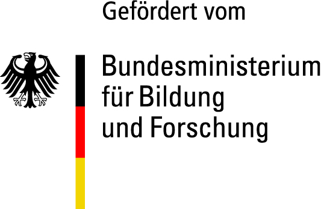

# WISYKI-API

Educational institutions create a wide range of courses, qualifications, and digital credentials. Describing what learners can gain from them in a clear, consistent way takes time. WISYKI-API helps institutions enrich this information with suggested learning outcomes, related skills, and summaries that can be reviewed and used in their metadata workflows.

The recommendations support people responsible for learning catalogs, qualification data, and digital credentials. They do not automatically publish or certify metadata; institutions remain in control of review and approval.

## What it offers

- Suggest learning outcomes from course or learning-opportunity information, or work with outcomes already provided.
- Connect each learning outcome separately to relevant skills in established frameworks.
- Prepare outcome titles and summaries in multiple languages while preserving provided information.
- Support metadata workflows for learning opportunities, qualifications, and digital educational credentials.

The API supports ESCO, DigCompESCO, GRETA, DigComp, DigCompEdu, and FutureSkills2030. The downloadable release of indexed skill data includes ESCO v1.2.0, GRETA v2, DKZ, DigComp 2.2 (ESCO), and DigCompEdu.

## How it works

WISYKI-API uses course information and any supplied learning outcomes to suggest clear outcome statements. It searches for related skills separately for each outcome, preserving the connection between outcomes and the skills that may describe them. It can also provide a multilingual summary. Institutions can review the recommendations before adding them to catalogs or credential systems.

The service uses FastAPI, PostgreSQL, Chroma, an embedding service, and an OpenAI-compatible LLM provider. The development setup includes local PostgreSQL, Chroma, and Hugging Face Text Embeddings Inference; the LLM provider is configured separately. Response statistics are optional, and background processing is available for longer requests.

For details on how recommendations relate to ELM/QualityLink, see [docs/metadata-workflow.md](./docs/metadata-workflow.md). For configuration, statistics, and background processing, see [docs/operations.md](./docs/operations.md).

## Local development

The repository's Docker Compose setup is intended for local development, not production deployment. You need Docker Compose v2, access to an OpenAI-compatible LLM provider, and the skill data distributed through the project's GitHub releases. Compose starts the local PostgreSQL, Chroma, and embedding services.

1. Clone this repository and enter its directory.
2. Download a skill-data archive from the [GitHub releases](https://github.com/ild-thl/wisyki-api/releases) and extract its indexed skill documents into `data/import`.
3. Create the local environment file from the template and configure the LLM provider and local service settings:

   ```bash
   cp .env.example .env
   ```

4. Build and start the development services:

   ```bash
   docker compose up --build -d
   ```

The API mounts `src/` from the host and reloads when source files change. Check service status and follow API logs with:

```bash
docker compose ps
docker compose logs -f wisyki-api
```

By default, the interactive API documentation is available at `http://localhost:7680/docs`; change `HOST_PORT` in `.env` to use another host port. Use `docker compose down` to stop the stack. Named volumes retain local database, Chroma, and embedding data.

The [hosted API documentation](https://wisyki-api.dev.dlc.sh/competence-analyser/docs) is the source of truth for endpoint request and response schemas.

## Tests

The unit and HTTP contract tests use fake providers and an isolated in-memory Chroma collection:

```bash
docker compose run --rm --no-deps \
  wisyki-api python -m unittest discover -s /code/tests -v
```

## Acknowledgements

This service uses the ESCO classification of the European Commission. WISYKI-API was developed as part of the WISY@KI project by the Institut für interaktive Systeme at the Technical University of Applied Sciences Lübeck and funded by the Federal Ministry of Education and Research.

<div style="display: flex; align-items: center; gap: 35px;">
    
    
</div>

## Support

For issues or assistance, please raise an issue in this repository.

## Contributing

Contributions are welcome.

## License

This project is licensed under the MIT License. See the [LICENSE](LICENSE) file for details.
